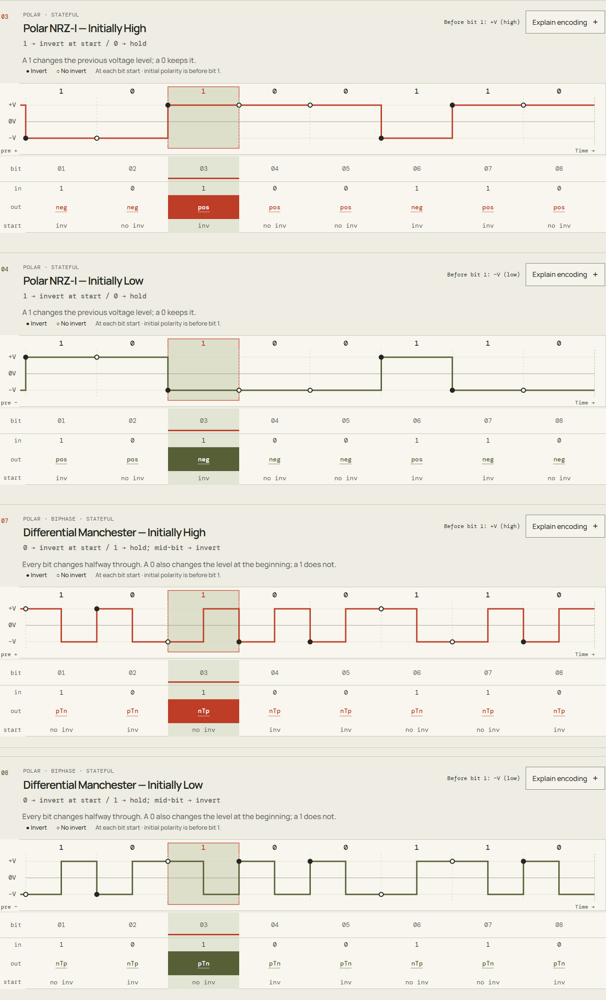
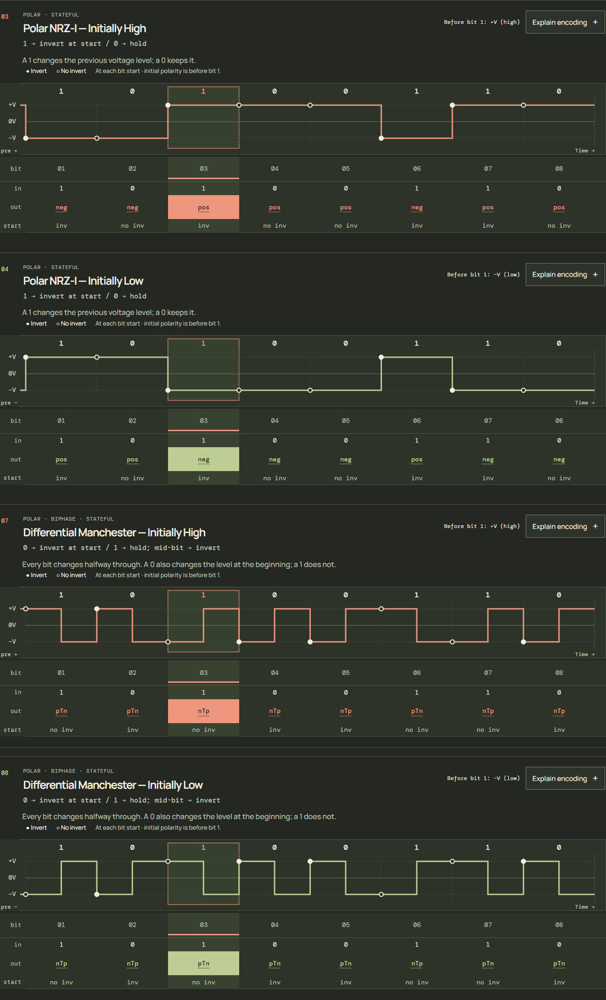
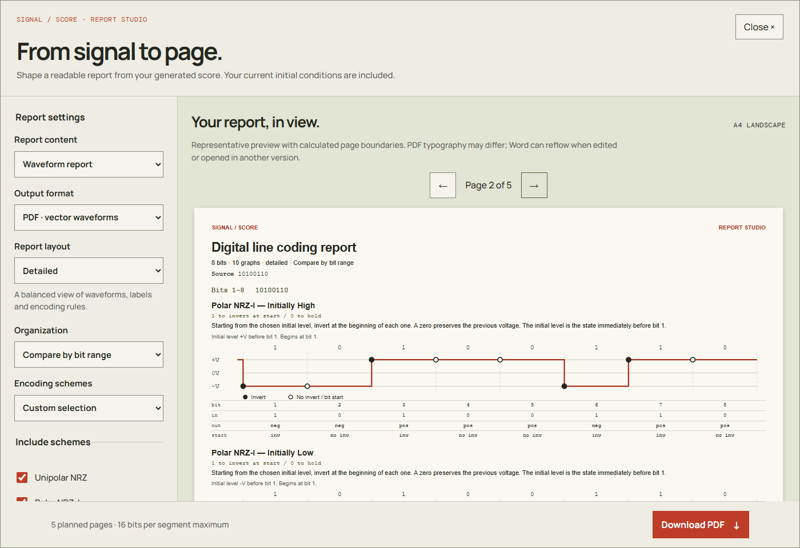

# SIGNAL / SCORE

An interactive digital signal laboratory for exploring how binary information becomes electrical waveforms.

Compose a binary sequence, compare ten waveform graphs across eight encoding families, and follow each bit through its voltage states. Signal / Score combines precise scientific diagrams with the **Kinetic Signal Score** identity: expressive typography, warm paper, ink, vermilion and olive, with coordinated motion and an accessible Night Mode.

**Live application: [signal-score-seven.vercel.app](https://signal-score-seven.vercel.app/)**

## Key features

- **Ten synchronized waveform graphs** with accurate SVG step waveforms, voltage axes, bit boundaries and aligned input/output tables.
- **Length-first input** from 1 to 128 bits, exact binary validation, an example sequence and randomization.
- **Bit inspection** across every scheme, contextual explanations and simultaneous Initially High and Initially Low graphs for NRZ-I and Differential Manchester.
- **Purposeful motion** with kinetic typography, synchronized waveform reveals, playback, seeking and an immediate reduced-motion alternative.
- **Day and Night themes** with saved/system preferences, keyboard navigation and responsive layouts.
- **Report Studio** for vector PDF, editable Word, Study reports, practice worksheets and separate answer keys, all generated locally.

NRZ-I and Differential Manchester each have two independent results. Initially High means +V immediately before bit 1; Initially Low means -V before bit 1. Solid circles mean invert at the bit start; hollow circles mean no invert. Every Differential Manchester bit also changes level at its midpoint.

See [graph definitions and reference verification](docs/TEN_GRAPHS.md) for the ordered results, sample fixtures and compatibility details.

## Screenshots

### Compare and inspect signals





### Report Studio



These are actual application captures. Print previews are representative; exported PDF typography and edited Word pagination can differ.

## Ten graphs across eight encoding families

| No. | Graph | Convention |
| --- | --- | --- |
| 01 | Unipolar NRZ | 1 = +V; 0 = 0V |
| 02 | Polar NRZ-L | 1 = -V; 0 = +V |
| 03 | Polar NRZ-I — Initially High | Pre-bit +V; 1 inverts, 0 holds |
| 04 | Polar NRZ-I — Initially Low | Pre-bit -V; 1 inverts, 0 holds |
| 05 | Polar RZ | 1 starts +V, 0 starts -V; second half returns to 0V |
| 06 | Manchester | 1 rises -V to +V; 0 falls +V to -V at midpoint |
| 07 | Differential Manchester — Initially High | Pre-bit +V; 0 inverts at start; every bit inverts at midpoint |
| 08 | Differential Manchester — Initially Low | Pre-bit -V; 0 inverts at start; every bit inverts at midpoint |
| 09 | Bipolar AMI | 0 = 0V; successive ones alternate +V and -V |
| 10 | Pseudoternary | 1 = 0V; successive zeros alternate +V and -V |

Both initial variants are visible together. Initial polarity applies before the entire stream, not before each segment. The first AMI/Pseudoternary nonzero pulse is positive. Voltages are normalized, not measured hardware signals.

## Mobile interface

Phone controls scroll naturally with the document. Previous / selector / Next, Edit / Export, playback and contextual inspection remain accessible without a large pinned panel. Waveforms and tables share horizontal scrolling with readable bit widths through 128 bits. The owner approved the refinement on a physical Android phone; automated coverage uses Chromium emulation. See [mobile behavior](docs/MOBILE_CONTROLS.md).

## Technology stack

| Area                | Tools                                        |
| ------------------- | -------------------------------------------- |
| Application         | React, strict TypeScript, Vite               |
| Visuals and motion  | SVG, custom CSS design system, GSAP          |
| Document generation | jsPDF, docx                                  |
| Verification        | Vitest, Playwright, PDF and OOXML inspectors |
| Typography          | Locally bundled Manrope Variable and DM Mono |

No backend, account, database or external runtime font service is required. Document libraries load when their format is requested.

## Installation and local development

Use Node.js **22.12+ within Node 22, or Node 24+**, with npm; the project is verified on Node 24. The lockfile is committed for reproducible installation.

```sh
git clone https://github.com/AzureZephyry/signal-score.git
cd signal-score
npm ci
npm run dev
```

Open the Local URL printed by Vite, normally **http://127.0.0.1:5173**. On Windows PowerShell, use `npm.cmd` if local execution policy blocks `npm.ps1`.

Confirm **Number of bits**, enter exactly that many 0/1 digits, then choose **Generate waveforms**. Select a bit to compare its outputs, or choose **Explain encoding** for contextual reasoning. Controls remain usable during animation; **Show all** completes a reveal immediately.

## Production build

```sh
npm run build
npm run preview
```

The build includes strict TypeScript checking. Preview the generated site at the printed URL, normally **http://127.0.0.1:4173**. `dist/` contains the static website, bundled fonts and font licenses. Serve it over HTTP; opening `index.html` directly through `file://` is not supported. Relative asset paths support hosting under a subdirectory.

Vercel automatically deploys main to the live website. Pull requests receive previews, which may need a review link under deployment protection. Release preparation does not change production configuration.

## Automated testing

```sh
npm run typecheck
npm test
npm run test:production -- --workers=1
```

The production browser command builds the site and tests that build. Tests use installed **Google Chrome**, with desktop and touch/mobile-emulated projects. If Chrome is unavailable, install it with `npx playwright install chrome` (CI/Linux environments may also need Playwright system dependencies).

The suite covers encoding rules, initial states, boundary continuity, validation, geometry, table alignment, playback, actual rendered motion, themes, focus, responsiveness and real PDF/Word download contents. One browser worker is recommended for frame-sensitive motion measurements, without concurrent document rendering.

See [QA.md](QA.md) for executed results, document review evidence and testing limits.

## Report Studio

After generating a score, choose **Export Report**. Studio uses the last generated sequence and current initial conditions, independently of playback position.

- **Formats:** vector PDF and editable Word (.docx).
- **Layouts:** Compact, Detailed and Study.
- **Organization:** compare by bit range or study by encoding scheme.
- **Content:** all ten or custom graphs; optional explanations, output tables, original bit-position rows, contextual reasoning and grayscale printing.
- **Practice:** empty waveform grids and blank answer cells, plus a separate answer-key export with the same source and initial conditions.

The complete stream is encoded before segmentation. Reports preserve state, pulse polarity and whole-bit boundaries through 128 bits. Printable bit capacity is calculated from page width, layout and label metrics; long inputs are never compressed onto one page. The interface includes a representative preview and calculated page plan.

Word reports contain real paragraphs/headings, editable tables and SVG diagrams with high-resolution PNG fallbacks. No Word installation is needed to generate a DOCX. Exports stay on the device; no sequence is uploaded. Edited documents or different Word versions/fonts can reflow.

See [Report Studio architecture and verification](REPORT_STUDIO.md).

## Project architecture

```text
src/
  lib/          Eight encoders, ten graph definitions, inversion decisions and validation
  hooks/        Playback, kinetic motion, reduced-motion and theme orchestration
  components/   Input, SVG waveforms, aligned tables and shared controls
  report/       Shared report model, segmentation, pagination, graphics and exports
  App.tsx       Application state and composition
tests/          Browser, motion, theme, readability and report workflow checks
public/         Favicon and font licenses
docs/           Reference documentation and curated screenshots
```

Encoding data is independent of animation. SVG paths use discrete voltage intervals, and the report module consumes complete calculations rather than webpage screenshots or separate export encoders.

- [Implemented design system](DESIGN.md)
- [Detailed usage, encoding fixtures and technical reference](docs/REFERENCE.md)
- [Readability review](READABILITY.md)
- [Motion verification](MOTION_RESTORATION.md)
- [Historical source notes](INTERNAL_REFERENCES.md)

## Branch and release workflow

Main contains merged Report Studio (PR #1), mobile controls (PR #2), and ten graphs with markers (PR #3). Hardening is reviewed through a separate PR. No tag or GitHub release is published until explicitly approved. See the [release checklist](RELEASE_CHECKLIST.md), [draft release notes](docs/RELEASE_NOTES_v1.0.0.md) and [security assessment](docs/DEPENDENCY_SECURITY.md).

## Verification baseline

The approved baseline passed 206 unit and 96 browser tests. [QA.md](QA.md) records current candidate evidence. Full audits include development tools; production-only audits do not.

```sh
npm audit
npm audit --omit=dev
npm run licenses:check
```

## Future development

Broader browser/device coverage, repository CI and a closer document preview are possible follow-ups, not implemented features.

## License status

**No application license is granted.** The owner explicitly retains reuse control while keeping GitHub public. Root LICENSE remains absent. Viewing or forking through GitHub does not grant general permission to reuse, modify, redistribute or commercially exploit the application; platform terms and legal exceptions still apply. Ask the owner for permission.

Third-party grants remain independent. Preserve [notices](THIRD_PARTY_NOTICES.md), [bundled texts](public/licenses/THIRD-PARTY-NOTICES.txt) and original font OFL files. GSAP has separate terms and is not relicensed by this repository. See [license assessment](docs/LICENSE_ASSESSMENT.md).
