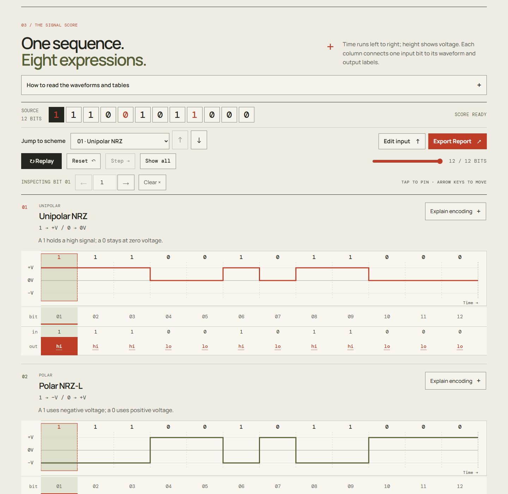
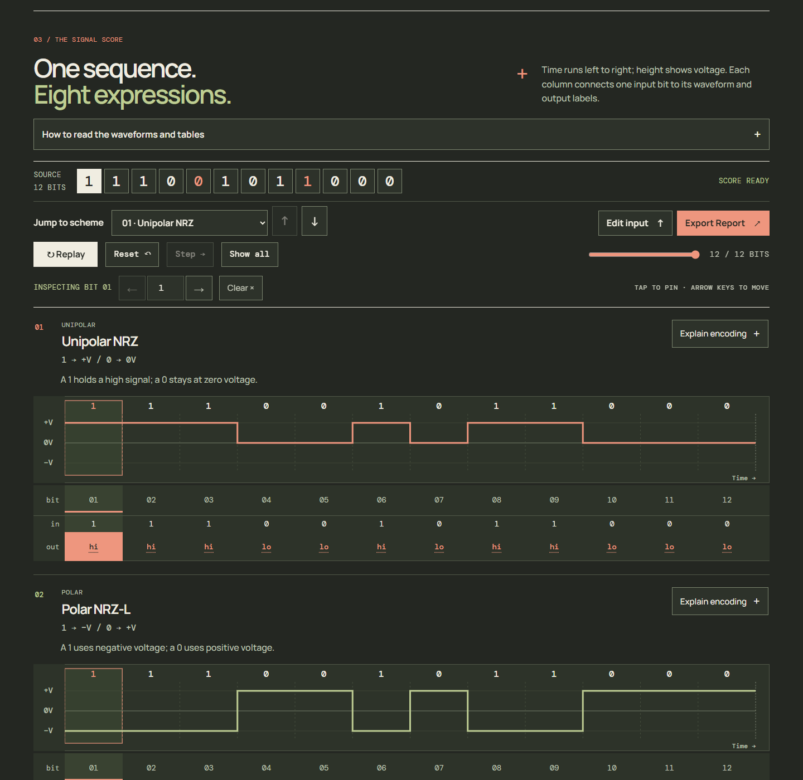
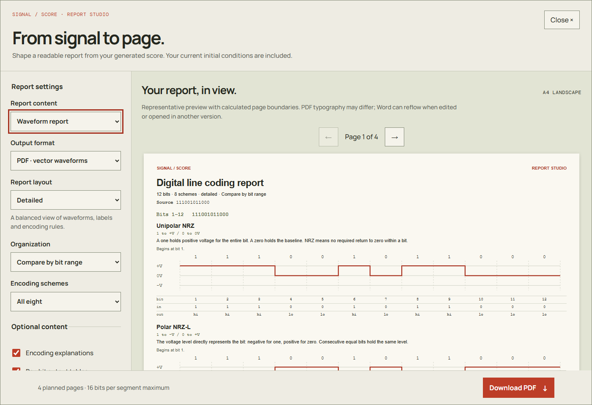

# SIGNAL / SCORE

An interactive digital signal laboratory for exploring how binary information becomes electrical waveforms.

Compose a binary sequence, compare eight line coding schemes, and follow each bit through its voltage states. Signal / Score combines precise scientific diagrams with the **Kinetic Signal Score** identity: expressive typography, warm paper, ink, vermilion and olive, with coordinated motion and an accessible Night Mode.

## Key features

- **Eight synchronized encodings** with accurate SVG step waveforms, voltage axes, bit boundaries and aligned input/output tables.
- **Length-first input** from 1 to 128 bits, exact binary validation, an example sequence and randomization.
- **Bit inspection** across every scheme, contextual explanations and independent initial conditions for NRZ-I and Differential Manchester.
- **Purposeful motion** with kinetic typography, synchronized waveform reveals, playback, seeking and an immediate reduced-motion alternative.
- **Day and Night themes** with saved/system preferences, keyboard navigation and responsive layouts.
- **Report Studio** for vector PDF, editable Word, Study reports, practice worksheets and separate answer keys, all generated locally.

## Screenshots

### Compare and inspect signals





### Report Studio



These are actual application captures. Print previews are representative; exported PDF typography and edited Word pagination can differ.

## Supported encoding schemes

| Scheme                  | Convention                                                     |
| ----------------------- | -------------------------------------------------------------- |
| Unipolar NRZ            | 1 = +V; 0 = 0V                                                 |
| Polar NRZ-L             | 1 = -V; 0 = +V                                                 |
| Polar NRZ-I             | 1 inverts at bit start; 0 holds the preceding level            |
| Polar RZ                | 1 starts at +V, 0 at -V; both return to 0V halfway through     |
| Manchester              | 1 = -V to +V; 0 = +V to -V at midpoint                         |
| Differential Manchester | 0 inverts at bit start; 1 holds; every bit inverts at midpoint |
| Bipolar AMI             | 0 = 0V; successive ones alternate +V and -V                    |
| Bipolar Pseudoternary   | 1 = 0V; successive zeros alternate +V and -V                   |

Both stateful polar schemes support initially high and initially low. The first nonzero AMI/Pseudoternary pulse is positive. Voltages are normalized relative levels, not measured hardware signals.

## Technology stack

| Area                | Tools                                        |
| ------------------- | -------------------------------------------- |
| Application         | React, strict TypeScript, Vite               |
| Visuals and motion  | SVG, custom CSS design system, GSAP          |
| Document generation | jsPDF, docx                                  |
| Verification        | Vitest, Playwright, PDF and OOXML inspectors |
| Typography          | Locally bundled Manrope Variable and DM Mono |

No backend, account, database or external runtime font service is required. Document libraries load when their format is requested.

## Installation and local development

Use Node.js **22.12 or newer**, with npm; the project is verified on Node 24. The lockfile is committed for reproducible installation.

```sh
git clone https://github.com/AzureZephyry/signal-score.git
cd signal-score
npm ci
npm run dev
```

Open the Local URL printed by Vite, normally **http://127.0.0.1:5173**. On Windows PowerShell, use `npm.cmd` if local execution policy blocks `npm.ps1`.

Confirm **Number of bits**, enter exactly that many 0/1 digits, then choose **Generate waveforms**. Select a bit to compare its outputs, or choose **Explain encoding** for contextual reasoning. Controls remain usable during animation; **Show all** completes a reveal immediately.

## Production build

```sh
npm run build
npm run preview
```

The build includes strict TypeScript checking. Preview the generated site at the printed URL, normally **http://127.0.0.1:4173**. `dist/` contains the static website, bundled fonts and font licenses. Serve it over HTTP; opening `index.html` directly through `file://` is not supported. Relative asset paths support hosting under a subdirectory.

Hosting is not configured as part of the repository setup.

## Automated testing

```sh
npm run typecheck
npm test
npm run test:production -- --workers=1
```

The production browser command builds the site and tests that build. Tests use installed **Google Chrome**, with desktop and touch/mobile-emulated projects. If Chrome is unavailable, install it with `npx playwright install chrome` (CI/Linux environments may also need Playwright system dependencies).

The suite covers encoding rules, initial states, boundary continuity, validation, geometry, table alignment, playback, actual rendered motion, themes, focus, responsiveness and real PDF/Word download contents. One browser worker is recommended for frame-sensitive motion measurements, without concurrent document rendering.

See [QA.md](QA.md) for executed results, document review evidence and testing limits.

## Report Studio

After generating a score, choose **Export Report**. Studio uses the last generated sequence and current initial conditions, independently of playback position.

- **Formats:** vector PDF and editable Word (.docx).
- **Layouts:** Compact, Detailed and Study.
- **Organization:** compare by bit range or study by encoding scheme.
- **Content:** all eight or custom schemes; optional explanations, output tables, original bit-position rows, contextual reasoning and grayscale printing.
- **Practice:** empty waveform grids and blank answer cells, plus a separate answer-key export with the same source and initial conditions.

The complete stream is encoded before segmentation. Reports preserve state, pulse polarity and whole-bit boundaries through 128 bits. Printable bit capacity is calculated from page width, layout and label metrics; long inputs are never compressed onto one page. The interface includes a representative preview and calculated page plan.

Word reports contain real paragraphs/headings, editable tables and SVG diagrams with high-resolution PNG fallbacks. No Word installation is needed to generate a DOCX. Exports stay on the device; no sequence is uploaded. Edited documents or different Word versions/fonts can reflow.

See [Report Studio architecture and verification](REPORT_STUDIO.md).

## Project architecture

```text
src/
  lib/          Pure encoders, normalized intervals, validation and explanations
  hooks/        Playback, kinetic motion, reduced-motion and theme orchestration
  components/   Input, SVG waveforms, aligned tables and shared controls
  report/       Shared report model, segmentation, pagination, graphics and exports
  App.tsx       Application state and composition
tests/          Browser, motion, theme, readability and report workflow checks
public/         Favicon and font licenses
docs/           Reference documentation and curated screenshots
```

Encoding data is independent of animation. SVG paths use discrete voltage intervals, and the report module consumes complete calculations rather than webpage screenshots or separate export encoders.

- [Implemented design system](DESIGN.md)
- [Detailed usage, encoding fixtures and technical reference](docs/REFERENCE.md)
- [Readability review](READABILITY.md)
- [Motion verification](MOTION_RESTORATION.md)
- [Historical source notes](INTERNAL_REFERENCES.md)

## Branch and release workflow

`main` holds the stable baseline; `feature/report-studio` contains the approved Report Studio work for review. The pull request is intentionally left open for final approval. A future **v1.0.0** release follows review and merge; this setup creates no release tag or deployment.

See the [release checklist](RELEASE_CHECKLIST.md).

## Future development

Potential follow-ups include broader browser/device coverage, automated repository CI, a closer document preview, and hosting configuration after the first stable merge. These are planned directions, not currently implemented features.

## License

No application license has been selected or added. Bundled font licenses remain under [`public/licenses/`](public/licenses/). A project license decision is separate from publishing the source.
